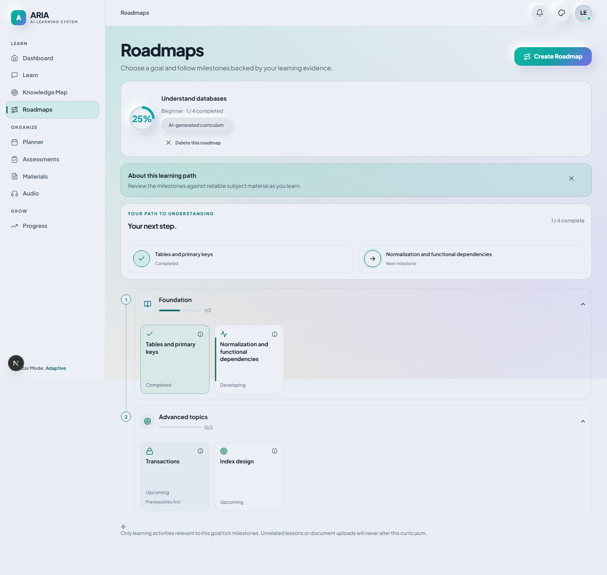
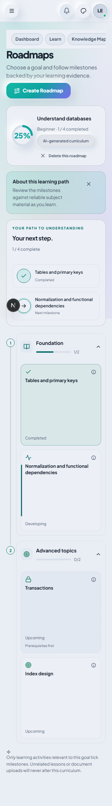
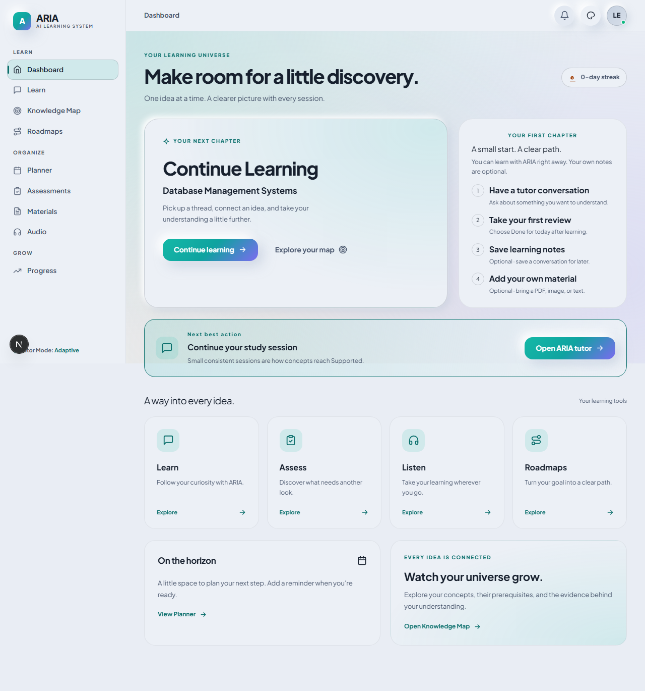

# ARIA frontend polish — implementation and verification

The six approved phases are implemented. This report covers the current frontend changes and their supporting API behaviour; it does not certify every feature in ARIA or live cloud-provider availability.

## What changed

| Phase | Result | Verification |
| --- | --- | --- |
| 1. Roadmap | Connected vertical phase timeline; compact square tiles; distinct completed, developing, next, upcoming and prerequisite-pending appearances; collapsed previews and phase progress; completion ring beside the goal and milestone count; dismissible explanation with persistent provenance badge. Tiles open the tutor with an editable topic prompt. A separate details control preserves prerequisite and evidence explanations. | Roadmap tests check tile dimensions, clipping and page width at 320, 375, 768 and 1440 px; prerequisite styling, collapsed preview, persisted dismissal, details and direct study links. Screenshots inspected on desktop and mobile. Existing completion-celebration and provenance regressions pass. |
| 2. Recovery and motion | Tutor errors include a reason and Retry reply. Retry preserves the request ID and avoids a duplicate question bubble or saved turn. Skeleton feedback changes after eight seconds. Done for today is an outlined button; the review banner has a Start review action and one brief entrance/pulse. Session titles remove leading emoji and retain a full-title tooltip. Focus visibly hides both conversation and workspace navigation. Long replies follow the latest message while preserving an earlier reading position. | Failed/recovered tutor requests, identical retry payloads, one question bubble, long-response scrolling, focus state, delayed replies, slow feedback and reduced motion checked in the browser. Backend replay, failed-request recovery, ownership and independent-connection SQLite concurrency tests pass. |
| 2. Shared notifications | Errors stay for eight seconds, other messages for three; notifications can be dismissed and pause while hovered or focused. They appear inside the active native dialog and survive its closure. API-error call sites now identify errors explicitly. Form errors for roadmap, assessment and notes generation are inline. | Modal top-layer hit testing, notification survival after closure, dismissal, overlapping expiry and audio regeneration/recovery regressions pass. |
| 3. First session | A guided checklist replaces the initial zero-progress ring. It links to a conversation, the first review, optional saved notes and optional uploaded material. The review step is complete only after submission. A created review points to Assessments. Next best action is directly below the hero; decorative orbit circles are removed. | Initial empty data, optional-material copy, checklist links, created-versus-submitted review and return to the progress ring checked. Failed progress remains retryable rather than implying zero mastery. |
| 4. Assessments | The modal checks ready-resource availability, explains material-based and conversation-based review paths, and blocks material-based creation when there is no ready material. Creation failures stay inside the modal and preserve the form. Assessment modes have readable labels and distinct badges. The empty state has an illustration and clear actions. | Readiness, inline failure/recovery and four badge labels/colours checked. Real material-based creation, answers and scoring pass. Populated assessment actions now use sufficient-contrast text in the light palette. |
| 5. Materials and audio | Add Material is the main action; Generate Notes is secondary and works from conversations without uploads. Saved notes and source resources have clearer wording. Note/upload errors are inline. Resource status labels are readable. Audio setup copy describes creating an episode and local speech where available. | Real text upload/deletion, conversation-note generation and PDF download pass. Note failures preserve the conversation selection. Audio provider/configuration wording and failure/playback/regeneration regressions pass. |
| 6. Mobile | A navigation drawer provides all workspace destinations, Account and subject selection. It contains keyboard focus, closes on Escape or destination selection, and restores the trigger. Existing quick navigation remains available. | Drawer keyboard containment, Escape, focus restoration and navigation checked. Width and accessibility sweeps cover the six changed screens; existing motion sweeps cover three palettes and five widths. |

## Deliberate adjustments to the supplied plan

- Uploaded notes and generated notes are optional. They do not block tutoring or conversation-based notes/reviews.
- Confidence is evidence confidence, not a percentage of a milestone completed. Developing tiles use an edge marker rather than inventing a completion percentage.
- Prerequisites are shown from the saved curriculum. Topics remain browsable; the frontend does not invent a lock or access-control rule.
- Resource readiness is a preliminary check. There is no fabricated “N materials” requirement. Very short material may still be insufficient, and the backend's explanation appears inside the modal.
- The permanent provenance badge distinguishes AI, starter and legacy plans, even after the explanatory banner is dismissed.
- Audio copy does not promise a configured provider is available, or falsely claim that playback uses a browser voice.

## Supporting backend changes

Tutor messages accept an optional request UUID. The reservation is scoped to the learner and session; response checkpointing and the conversation pair commit together. A deterministic user-message identity allows safe replay even after a short-lived request key is cleaned up. Existing clients without a request UUID retain their previous path.

Assessment summaries expose `submitted_attempt_count`, derived from existing attempts and scoped to the authenticated learner. This lets the first-session checklist distinguish creating a review from submitting one. The frontend API declarations were regenerated from the local backend's OpenAPI schema, including this count and the optional tutor request UUID. No new database migration is required for these changes.

## Verification results

- New frontend-polish suite: **13 passed**. The final prerequisite styling/direct-link recheck also passed.
- Existing motion/review batch: **72 passed, 1 failed** initially; the failure was an inconsistent test fixture that removed the just-created chat from the session list. The corrected full new UI suite passes, including repeated long replies. All 20 existing motion tests and all 41 existing review-regression tests passed in that batch.
- Connected learning/materials/assessment batch: **10 passed, 1 failed** initially. The failure expected the intentionally removed technical chunk count. After replacing that assertion with ready status and the concepts link, the final connected recheck passed **6/6**, including daily review and chat-based notes. The full cross-feature journey passed in the initial connected batch.
- Tutor/idempotency/resource backend regression batch: **43 passed, 4 skipped**. Assessment/daily-review batch: **27 passed, 1 skipped**. Final independent SQLite retry check: **3 passed, 1 skipped**. These overlap; the numbers are not a unique-test total. Skips are PostgreSQL-specific checks because the Docker engine was unavailable.
- TypeScript and changed-file ESLint: **passed**.
- Default Next.js Turbopack production build: **passed**, including TypeScript and all 19 static pages. Initial compiler-cache/subprocess failures were resolved with a fresh isolated build directory. The extra Webpack diagnostic was stopped once the default build passed.

Browser integration used a separate local SQLite database, frontend port 3130 and backend port 8030, with cloud keys disabled. This verifies local integration and UI recovery; it does not verify a live Groq response. The ordinary app database and real API keys were not changed for these checks.

## Screenshots

These show the actual rendered frontend using explicit test fixtures.

## Deferred enhancements

Assessment score trends are now implemented; see the [release verification follow-up](ui-polish-release-verification-2026-10-14.md) for the full test run and desktop/mobile screenshot matrix. Weekly goals, extra achievement systems and podcast enhancements remain separate feature work. No separate onboarding-tour library was added; the first-session checklist supplies the guided flow.
